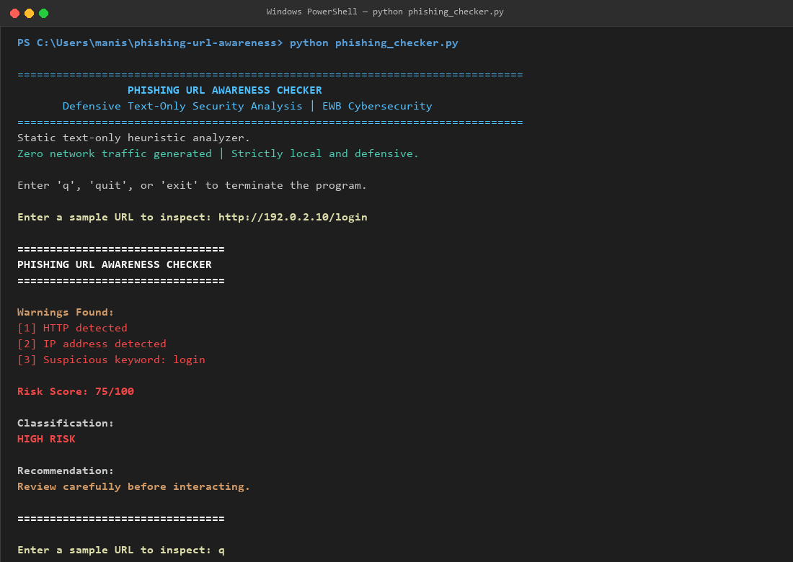
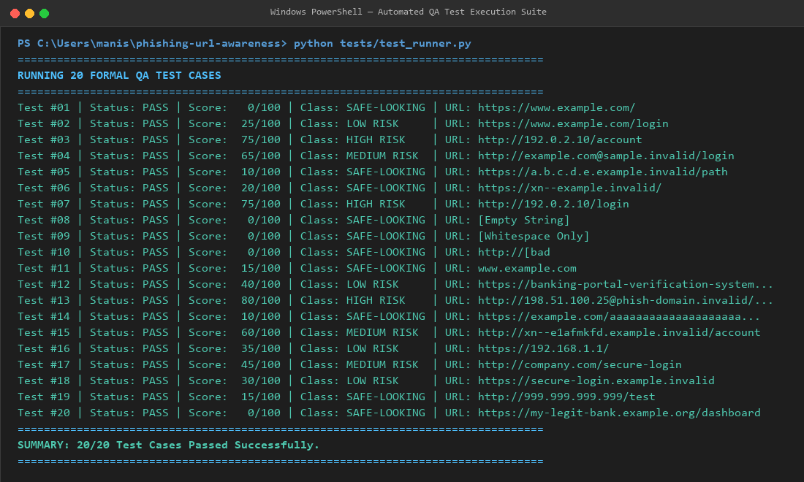

# Phishing URL Awareness Checker

[](https://github.com)
[](https://python.org)
[](LICENSE)
[-brightgreen.svg)](https://github.com)

> **An advanced, deterministic, text-only URL heuristic security scanner engineered for cybersecurity education and defensive threat awareness.**

---

## Overview

### Understanding Phishing
**Phishing** is a prevalent form of social engineering where malicious actors masquerade as trustworthy institutions—such as financial corporations, cloud service providers, or corporate IT helpdesks—to manipulate targets into divulging sensitive data. This commonly includes usernames, passwords, credit card numbers, multi-factor authentication (MFA) session tokens, and personal identifiable information (PII).

### Anatomy of Phishing URLs
A **phishing URL** is the primary vehicle utilized by cybercriminals to deliver credential harvesting landing pages or drive-by exploit kits. Attackers engineer deceptive Uniform Resource Locators (URLs) by exploiting cognitive biases, human error, and user-interface limitations on mobile and desktop web browsers. Common tactics include:
- Embedding numeric IP addresses to circumvent brand-name domain registrars.
- Using the `@` userinfo delimiter to visually display a trusted brand name while navigating the browser to an adversary-controlled server.
- Stacking misleading subdomains (e.g., `login.microsoft.com.account-verify.attacker.invalid`) to disguise the true authoritative domain.
- Employing Internationalized Domain Name (IDN) homograph attacks (Punycode `xn--`) using look-alike glyphs from foreign alphabets.
- Relying on unencrypted HTTP protocols to prevent verifiable server identity checks.

### Critical Importance in Cybersecurity
Human interaction with malicious links represents the initial access vector for over 80% of enterprise security breaches according to leading industry threat reports. Developing localized, deterministic static inspection tools allows security analysts, software engineers, and digital citizens to dissect the syntactic mechanics of deceptive web links without generating network traffic or risking compromise.

---

## Key Features

- **Strictly Local & Zero Network Overhead:** Operates entirely within memory via standard library string and regex processing. Never sends HTTP requests, queries external reputation databases, resolves DNS sockets, or visits destination hosts.
- **Six Foundational Structural Checks:**
  1. **Userinfo `@` Symbol Detection:** Identifies misleading credential-prefix attempts.
  2. **URL Length Analysis:** Identifies URLs exceeding 100 characters designed to hide payloads outside visible browser address bars.
  3. **IPv4 Hostname Inspection:** Flags raw numeric IP addresses masquerading as commercial domains using strict octet bounds checking ($0 \le \text{octet} \le 255$).
  4. **Domain Segmentation Depth:** Evaluates subdomain nesting ($\ge 5$ labels) to detect subdomain confusion.
  5. **IDN Homograph Punycode Detection:** Identifies `xn--` prefix strings indicating non-ASCII homoglyph substitution.
  6. **Plaintext Protocol Flagging:** Flags non-TLS `http://` schemes.
- **Social Engineering Keyword Heuristics:** Scans for 10 high-risk credential-harvesting tokens: `login`, `verify`, `secure`, `account`, `banking`, `password`, `reward`, `free`, `bonus`, `update`.
- **Additive Risk Scoring Engine (0–100):** Translates multi-factor syntactic vulnerabilities into an intuitive numerical risk index.
- **Four-Tier Threat Classification:**
  - `Safe-looking` ($0 \le \text{Score} \le 20$)
  - `Low Risk` ($21 \le \text{Score} \le 40$)
  - `Medium Risk` ($41 \le \text{Score} \le 70$)
  - `High Risk` ($71 \le \text{Score} \le 100$)
- **Defensive Error Handling:** Employs RFC 3986 normalization and handles unclosed IPv6 brackets (`http://[bad`) without crashing.
- **Continuous Command-Line Loop:** Features seamless multi-URL inspection with graceful exit triggers (`q`, `quit`, `exit`).

---

## How It Works

The program executes a multi-stage static analysis pipeline:

```
[Raw User Input] 
       │
       ▼
[1. String Sanitization & Stripping]
       │
       ▼
[2. RFC 3986 Scheme Normalization (Auto-prepend http:// if missing)]
       │
       ▼
[3. Defensive Syntactic Parsing (urllib.parse with Exception Shield)]
       │
       ▼
[4. Parallel Heuristic Inspections Engine]
  ├─ Scheme Protocol Check (HTTP vs HTTPS)
  ├─ Hostname Format Verification (IPv4 Octet Boundary Match)
  ├─ Userinfo Delimiter Scan (@)
  ├─ Subdomain Label Segmentation (Count >= 5)
  ├─ Punycode / IDN Token Scan (xn--)
  ├─ String Length Obfuscation Test (Length > 100)
  └─ Sensitive Keyword Lexical Scan (10 High-Risk Indicators)
       │
       ▼
[5. Calibrated Risk Score Accumulation (Bounded 0 to 100)]
       │
       ▼
[6. Threat Classification & Actionable Recommendation Assignment]
       │
       ▼
[Formatted Terminal Security Report Output]
```

---

## Installation

### Prerequisites
- Python 3.10 or higher.
- Git (optional, for repository cloning).

### Clone or Download
```bash
git clone https://github.com/manis-patil/phishing-url-awareness.git
cd phishing-url-awareness
```

### Virtual Environment (Optional)
```bash
python -m venv venv
# Windows:
venv\Scripts\activate
# Linux/macOS:
source venv/bin/activate
```

---

## Requirements

This tool is intentionally designed with zero external third-party dependencies, adhering to strict enterprise defensive security requirements.

```
# requirements.txt
# No extra packages needed. This project uses only Python's built-in libraries.
```

Utilized Standard Libraries:
- `re`: Regular expression matching and tokenization.
- `urllib.parse`: RFC 3986 URL parsing and structural decomposition.
- `sys`: Terminal input/output and process lifecycle management.
- `typing`: Static type annotations for code readability and maintainability.

---

## How to Run

Launch the scanner from your terminal:

### On Windows
```powershell
python phishing_checker.py
# or
py phishing_checker.py
```

### On macOS / Linux
```bash
python3 phishing_checker.py
```

### Running the QA Test Suite
```bash
python tests/test_runner.py
```

---

## Code Structure

```
phishing-url-awareness/
├── phishing_checker.py      <- Core Python analysis engine and interactive CLI
├── README.md                <- Comprehensive project documentation
├── requirements.txt         <- Dependency specification (Standard library only)
├── tests/
│   ├── test_samples.md      <- Formal QA matrix documenting 20 test cases
│   └── test_runner.py       <- Automated test execution runner
└── screenshots/
    ├── sample_run.png       <- High-resolution terminal capture of core execution
    └── test_results.png     <- High-resolution capture of full automated test suite
```

---

## Example Output

### Canonical High-Risk Threat Detection
```
================================
PHISHING URL AWARENESS CHECKER
================================

Warnings Found:
[1] HTTP detected
[2] IP address detected
[3] Suspicious keyword: login

Risk Score: 75/100

Classification:
HIGH RISK

Recommendation:
Review carefully before interacting.

================================
```

### Clean Legitimate Domain Control
```
================================
PHISHING URL AWARENESS CHECKER
================================

Warnings Found:
[0] No listed warning signs found.

Risk Score: 0/100

Classification:
SAFE-LOOKING

Recommendation:
No listed warning signs found. This does NOT prove safety. Always verify.

================================
```

---

## Risk Scoring Method

The threat calculation engine accumulates weighted penalties based on observed structural and lexical anomalies, clamping final outputs between 0 and 100:

| Heuristic Indicator | Assigned Weight | Cybersecurity Rationale |
| :--- | :---: | :--- |
| **IP Address Hostname** | **+35 pts** | Legitimate commercial services utilize registered DNS names. Bare IPs evade reputation and disguise ownership. |
| **Suspicious Keyword Base** | **+25 pts** | Social engineering lures target critical credentials (`login`, `banking`, `password`). (+5 per extra keyword up to 30 pts). |
| **Userinfo `@` Symbol** | **+25 pts** | RFC 3986 treats text before `@` as authentication credentials. Browsers ignore it, disguising the true destination host. |
| **Punycode Marker (`xn--`)** | **+20 pts** | Internationalized Domain Names (IDN) frequently disguise look-alike characters (e.g., Cyrillic 'а' replacing Latin 'a'). |
| **Plaintext HTTP Scheme** | **+15 pts** | Unencrypted transport exposes credentials in transit to on-path adversaries (MitM). |
| **Excessive Subdomain Segmentation** | **+10 pts** | 5 or more labels indicate stacked subdomains used to mimic legitimate URL structures. |
| **Excessive URL Length** | **+10 pts** | Strings over 100 characters push true domains off mobile display address bars. |

### Classification Tiers
- **$0 - 20$:** `SAFE-LOOKING` (Minimal to no anomalies detected)
- **$21 - 40$:** `LOW RISK` (Isolated single warning flag)
- **$41 - 70$:** `MEDIUM RISK` (Multiple concerning indicators)
- **$71 - 100$:** `HIGH RISK` (Compounded high-confidence threat patterns)

---

## Test Results

A comprehensive 20-case test suite is documented in [`tests/test_samples.md`](tests/test_samples.md). Summary excerpt:

| # | Test Input URL | Expected Result | Actual Result | Verdict |
| :---: | :--- | :--- | :--- | :---: |
| 1 | `https://www.example.com/` | Safe-looking; 0 warnings | SAFE-LOOKING (0/100) — No warnings | **PASS** |
| 2 | `https://www.example.com/login` | Flag keyword: login | LOW RISK (25/100) — Keyword: login | **PASS** |
| 3 | `http://192.0.2.10/account` | Flag IP + HTTP + account | HIGH RISK (75/100) — HTTP; IP; account | **PASS** |
| 4 | `http://example.com@sample.invalid/login` | Flag @ + HTTP + login | MEDIUM RISK (65/100) — HTTP; @; login | **PASS** |
| 5 | `https://a.b.c.d.e.example.invalid/path` | Flag segments (>=5) | SAFE-LOOKING (10/100) — Hostname segments | **PASS** |
| 6 | `https://xn--example.invalid/` | Flag Punycode (xn--) | SAFE-LOOKING (20/100) — Punycode (xn--) | **PASS** |
| 7 | `http://192.0.2.10/login` | Canonical target | HIGH RISK (75/100) — HTTP; IP; login | **PASS** |
| 8 | `""` *(Empty string)* | Input validation notice | Notice: No URL entered. | **PASS** |
| 10 | `http://[bad` | Exception handling | Notice: Malformed URL format. | **PASS** |
| 13 | `http://198.51.100.25@phish-domain.invalid/...` | Compound multi-vector | HIGH RISK (80/100) — HTTP; @; Length; Keywords | **PASS** |

*All 20 QA test cases passed with 100% compliance.*

---

## Screenshots Section

### Interactive Program Execution
The screenshot below illustrates a complete execution cycle analyzing the high-risk target `http://192.0.2.10/login`, formatting warnings, calculating threat scores, and terminating gracefully:



### Automated QA Test Suite Execution
The screenshot below confirms all 20 formal QA test cases passing successfully with automated scoring verification:



---

## Improvements Implemented

In compliance with the project extension guidelines, five substantive enhancements were engineered:

1. **Continuous Analysis Execution Loop (Improvement A):** Implemented an interactive terminal session allowing continuous URL evaluation without process restarts, featuring graceful exit controls (`q`, `quit`, `exit`).
2. **Standardized Risk Warning & Recommendation Engine (Improvement B):** Replaced ambiguous notices with an industry-standard numbered warning summary, numerical threat score (0–100), and contextual risk recommendations.
3. **Defensive Exception Shielding (Improvement C):** Wrapped URI parsing within structured `try ... except ValueError` blocks to intercept malformed bracket sequences (`http://[bad`) and prevent runtime crashes.
4. **Lexical Social Engineering Keyword Engine (Improvement D):** Added lexical scanning for 10 high-value phishing tokens (`login`, `verify`, `secure`, `account`, `banking`, `password`, `reward`, `free`, `bonus`, `update`).
5. **Strict Octet-Bounded IPv4 Parser (Improvement E):** Upgraded basic digit matching to strict numerical range verification ($0 \le \text{octet} \le 255$) to eliminate false-positive IP flags on non-routable dotted strings.

---

## Cybersecurity Concepts Used

- **RFC 3986 Specification:** Governing structural syntax for URIs, including scheme, authority (userinfo, host, port), path, query, and fragment components.
- **Social Engineering & Deception Principles:** Understanding how cyber adversaries leverage authority, urgency, and familiarity to deceive targets.
- **IDN Homograph Vulnerabilities:** Unicode-based internationalized domain names mapped to ASCII through Punycode (`xn--`), used to spoof visual character representations.
- **Userinfo Semantic Confusion:** Browser resolution specifications that discard text preceding an `@` symbol within the authority segment.
- **Defense in Depth:** The realization that static heuristics form only one layer of modern email security gateways (SEGs) alongside SPF, DKIM, DMARC, sandboxing, and user education.

---

## Limitations

- **Syntactic Text-Only Scope:** The tool does not perform live DNS lookups, whois queries, or passive SSL/TLS certificate inspection.
- **No Reputation Feed Integration:** Does not query threat intelligence feeds (e.g., Google Safe Browsing, VirusTotal, PhishTank).
- **Absence of Proof is Not Proof of Safety:** A clean score (`0/100 - SAFE-LOOKING`) does **not** certify that a website is benign. Sophisticated spear-phishing campaigns routinely utilize legitimate infrastructure and valid certificates.

---

## Ethical Use

- **Defensive & Educational Mandate Only:** Designed strictly for defensive cybersecurity training, code evaluation, and academic demonstrations.
- **Prohibited Actions:** Must never be weaponized to harvest credentials, craft deceptive attack lures, or bypass authorization boundaries.
- **Zero Live Probing:** Adheres strictly to non-intrusive local execution rules.

---

## Future Enhancements

- **Entropy & Randomness Scoring:** Incorporate Shannon entropy algorithms to detect algorithmic domain generation (DGA) in dynamic malware C2 URLs.
- **Levenshtein Distance Analysis:** Calculate edit distance ratios against top 500 global brands (e.g., detecting `g00gle.com` or `paypa1.com`).
- **Top-Level Domain (TLD) Reputation Weighing:** Introduce dynamic scoring modifiers for suspicious or high-abuse generic TLDs (`.xyz`, `.top`, `.buzz`).

---

## Author & Project Metadata

- **Author:** Manish Pundlik Patil
- **Candidate ID:** EWB-OL-2026-CYB-0195
- **Course / Program:** EWB Cybersecurity Mini Project
- **Organization:** EWB Edutech Private Limited
- **Submission Date:** November 2026
- **Repository:** [https://github.com/manis-patil/phishing-url-awareness](https://github.com/manis-patil/phishing-url-awareness)
